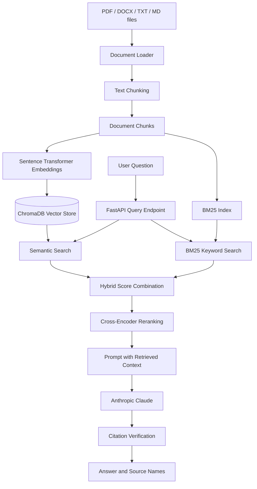

# RAG Hybrid Search

A Retrieval-Augmented Generation (RAG) application built with **Python and FastAPI**. It combines semantic vector search and BM25 keyword search to retrieve relevant document passages, reranks the candidates, and uses **Anthropic Claude** to generate an answer grounded in the retrieved context.

## Overview

Traditional keyword search is effective when a query contains the same terms as a document. Semantic search can retrieve passages with similar meaning even when the wording differs. This project combines both retrieval approaches so that relevant passages can be found using lexical and semantic signals.

The application currently provides API endpoints for ingesting local documents and asking questions about the indexed content.

## Features

- **Document ingestion:** Extracts text from PDF, DOCX, TXT, and Markdown files.
- **Text chunking:** Splits documents into overlapping word-based chunks to preserve context between neighboring chunks.
- **Semantic retrieval:** Generates embeddings with Sentence Transformers and stores them in persistent ChromaDB.
- **Keyword retrieval:** Uses BM25 through `rank-bm25` to find passages matching query terms.
- **Hybrid retrieval:** Combines normalized semantic and BM25 scores using a configurable blend in the retrieval function.
- **Reranking:** Uses a Sentence Transformers Cross-Encoder to rerank retrieved candidates for the question.
- **LLM answer generation:** Sends the question and retrieved context to Anthropic Claude.
- **Citation checking:** Checks whether source names cited in the answer exist among the retrieved passages and returns a grounding flag.
- **API documentation:** FastAPI provides interactive Swagger documentation.
- **Container support:** Includes a Dockerfile and Docker Compose configuration.

## Architecture



## Technology Stack

| Component | Technology | Purpose |
|---|---|---|
| Language | Python 3.11 | Application development |
| API framework | FastAPI | HTTP API endpoints |
| API server | Uvicorn | Runs the FastAPI application |
| Semantic embeddings | Sentence Transformers (`all-MiniLM-L6-v2`) | Converts text and questions into vectors |
| Vector database | ChromaDB | Persistent storage and similarity search for document chunks |
| Keyword retrieval | `rank-bm25` | BM25-based lexical search |
| Reranking | Sentence Transformers Cross-Encoder (`cross-encoder/ms-marco-MiniLM-L-6-v2`) | Reranks candidate passages against the question |
| LLM | Anthropic Claude | Generates context-based answers |
| Document parsing | pypdf, python-docx | Reads PDF and DOCX documents |
| Configuration | Pydantic Settings | Loads application settings from environment variables |
| Containerization | Docker, Docker Compose | Builds and runs the application in a container |

## Project Structure

```text
Rag-Hybrid-Search/
├── app/
│   ├── api/
│   │   └── routes.py              # Ingestion and question-answering endpoints
│   ├── generation/
│   │   ├── citation_check.py      # Checks cited source names
│   │   ├── llm.py                 # Anthropic Claude integration
│   │   └── prompt.py              # Builds the RAG prompt and context
│   ├── ingestion/
│   │   ├── loader.py              # Loads PDF, DOCX, TXT, and MD files
│   │   └── chunker.py             # Splits text into overlapping chunks
│   ├── models/
│   │   └── schemas.py             # Pydantic request and response models
│   ├── retrieval/
│   │   ├── bm25_store.py          # BM25 index and persistence
│   │   ├── embeddings.py           # Sentence Transformer embeddings
│   │   ├── hybrid.py               # Combines dense and BM25 results
│   │   ├── reranker.py             # Cross-Encoder reranking
│   │   └── vector_store.py         # ChromaDB operations
│   ├── config.py                   # Application configuration
│   └── main.py                     # FastAPI application entry point
├── data/
│   ├── raw/                        # Put source documents here before ingestion
│   └── processed/                  # Reserved for processed data
├── storage/
│   └── chroma/                     # Persistent ChromaDB data
├── tests/                          # Automated tests
├── .env.example                    # Environment variable template
├── Dockerfile
├── docker-compose.yml
├── requirements.txt
└── README.md
```

## Getting Started

### Prerequisites

- Python 3.11
- An Anthropic API key
- Git

### 1. Clone the repository

```bash
git clone https://github.com/Abhinaya3107/Rag-Hybrid-Search.git
cd Rag-Hybrid-Search
```

### 2. Create and activate a virtual environment

**Windows (PowerShell):**

```powershell
python -m venv venv
.\venv\Scripts\Activate.ps1
```

** macOS / Linux:**

```bash
python3 -m venv venv
source venv/bin/activate
```

### 3. Install dependencies

```bash
python -m pip install --upgrade pip
pip install -r requirements.txt
```

### 4. Configure environment variables

Create a local `.env` file by copying the example file.

**Windows (PowerShell):**

```powershell
Copy-Item .env.example .env
```

**macOS / Linux:**

```bash
cp .env.example .env
```

Open `.env` and set your Anthropic API key:

```env
ANTHROPIC_API_KEY=your_anthropic_api_key

EMBEDDING_MODEL=all-MiniLM-L6-v2
RERANKER_MODEL=cross-encoder/ms-marco-MiniLM-L-6-v2
LLM_MODEL=claude-sonnet-4-5
```

Keep your real `.env` file private. Do not commit API keys or other secrets to GitHub.

### 5. Add documents

Place the documents you want to search in `data/raw/`. Supported formats are:

- PDF (`.pdf`)
- Microsoft Word (`.docx`)
- Text (`.txt`)
- Markdown (`.md`)

### 6. Start the API

From the repository root, run:

```bash
uvicorn app.main:app --reload
```

The API will be available at:

- Base URL: `http://127.0.0.1:8000`
- Swagger UI: `http://127.0.0.1:8000/docs`
- ReDoc: `http://127.0.0.1:8000/redoc`

The first run may take longer because the embedding and reranker models need to be downloaded.

## API Endpoints

### `GET /health`

Checks whether the API process is running.

Example response:

```json
{
  "status": "healthy"
}
```

### `POST /ingest`

Loads supported files from `data/raw/`, splits their text into chunks, creates embeddings, stores the chunks in ChromaDB, and builds the BM25 index.

No request body is required. Run ingestion after adding documents and before querying them.

Example response:

```json
{
  "status": "ok",
  "chunks_indexed": 12
}
```

The number above is illustrative; the actual value depends on the documents.

### `POST /query`

Searches the indexed documents and generates an answer using the retrieved context.

Example request:

```json
{
  "question": "What are the main points covered in the document?",
  "top_k": 5
}
```

Example response:

```json
{
  "answer": "Answer generated from the retrieved document context. [example.pdf]",
  "sources": [
    "example.pdf"
  ],
  "fully_grounded": true
}
```

The response above is illustrative. `fully_grounded` indicates whether the source names cited in the generated answer match source names in the retrieved chunks. It is a citation-name check, not a guarantee that every factual statement is correct.

## Configuration

The following settings are defined in `app/config.py` and can be overridden through environment variables.

| Setting | Default | Description |
|---|---|---|
| `ANTHROPIC_API_KEY` | Required | API key used to call Anthropic Claude |
| `EMBEDDING_MODEL` | `all-MiniLM-L6-v2` | Sentence Transformer embedding model |
| `RERANKER_MODEL` | `cross-encoder/ms-marco-MiniLM-L-6-v2` | Cross-Encoder reranking model |
| `LLM_MODEL` | `claude-sonnet-4-5` | Anthropic model identifier |
| `CHUNK_SIZE` | `500` | Maximum words in each chunk |
| `CHUNK_OVERLAP` | `50` | Overlapping words between chunks |
| `TOP_K_DENSE` | `10` | Number of semantic-search candidates |
| `TOP_K_BM25` | `10` | Number of BM25 candidates |
| `TOP_K_FINAL` | `5` | Configured final retrieval count |
| `CHROMA_PATH` | `storage/chroma` | Persistent ChromaDB directory |
| `BM25_PATH` | `storage/bm25_index.pkl` | BM25 index file path |

The `/query` request's `top_k` value is used for the reranking result count.

## Run with Docker

Make sure `.env` exists and contains your Anthropic API key. From the repository root, run:

```bash
docker compose up --build
```

Open `http://localhost:8000/docs` to use the API. The Compose configuration maps `data/` and `storage/` to the container so documents and persisted retrieval data remain available on the host.

To stop the container:

```bash
docker compose down
```

## How Hybrid Search Works

1. **Semantic search:** The question is converted into an embedding and compared with document embeddings in ChromaDB.
2. **Keyword search:** BM25 ranks document chunks based on query-term relevance.
3. **Score combination:** The two result lists are normalized and combined. The current implementation uses an equal weighting (`alpha = 0.5`) by default.
4. **Reranking:** A Cross-Encoder evaluates each candidate against the original question and sorts candidates by relevance.
5. **Generation:** The selected chunks are added to a prompt and sent to Claude.
6. **Citation check:** Source names cited in the answer are compared with the sources in the retrieved chunks.

## Current Scope and Notes

- This is an API-based project; the repository does not currently include a separate web frontend.
- Documents are read from the local `data/raw/` directory for ingestion.
- ChromaDB and the BM25 index are persisted locally under `storage/`.
- Run `/ingest` after adding documents so they are available to `/query`.
- Citation verification checks source-name references; it does not independently validate the truth of generated claims.

## Author

**Abhinaya Angaitkar**

- GitHub: [Abhinaya3107](https://github.com/Abhinaya3107)
- Repository: [Rag-Hybrid-Search](https://github.com/Abhinaya3107/Rag-Hybrid-Search)

---

If you find this project useful, feel free to explore the code and suggest improvements.
